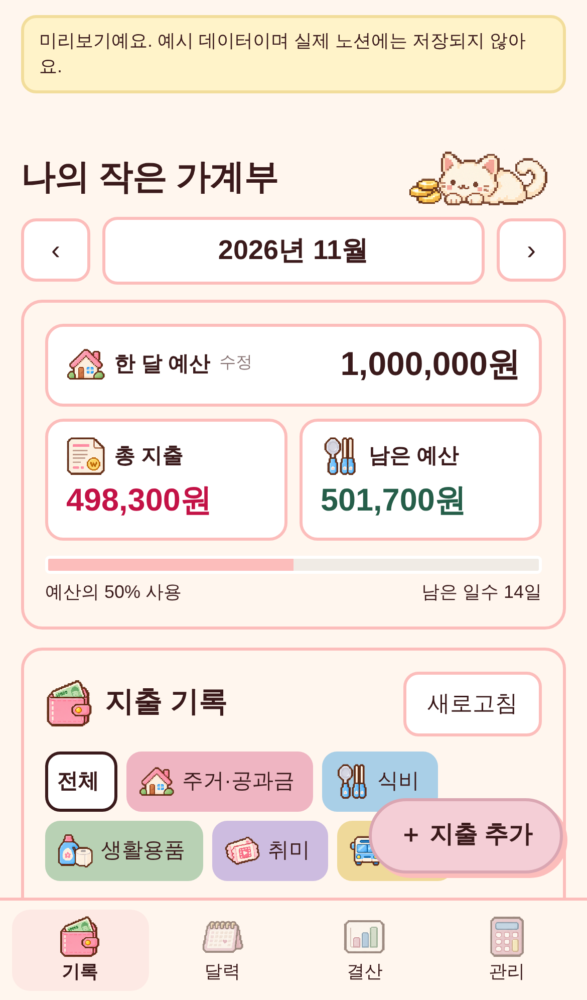
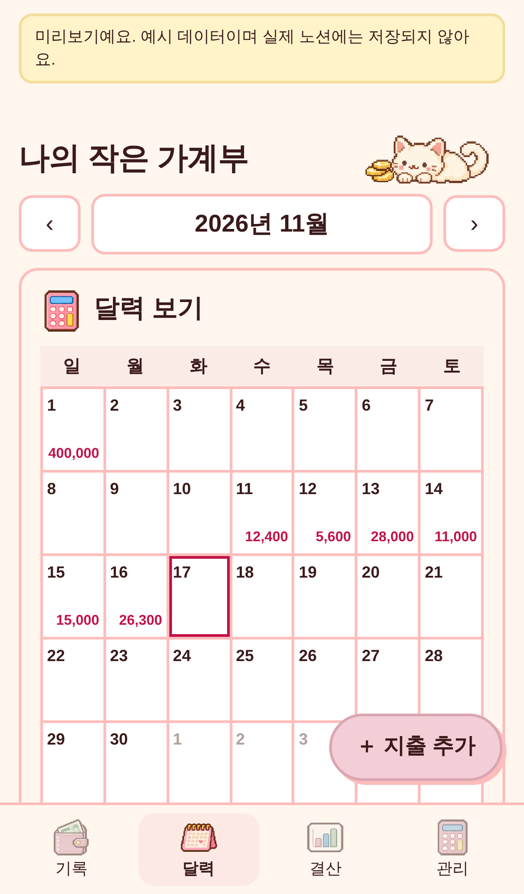
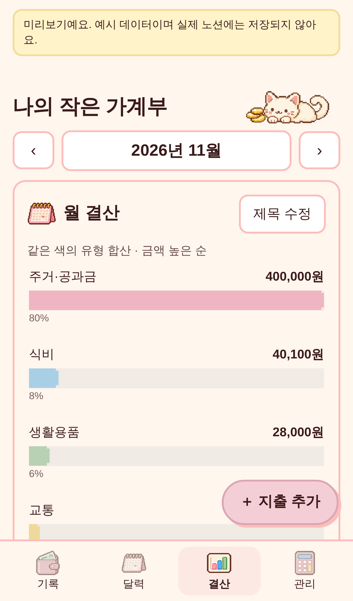
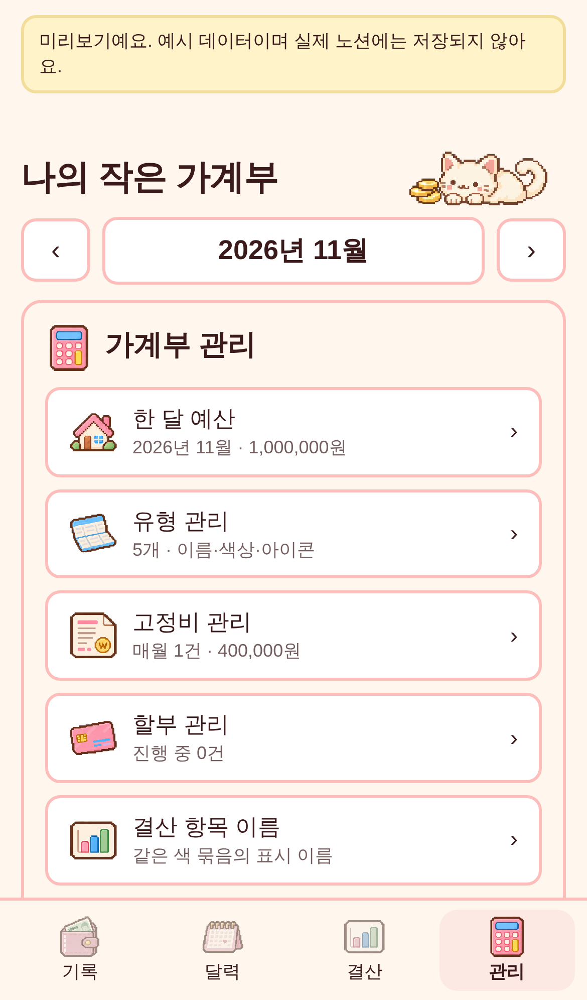
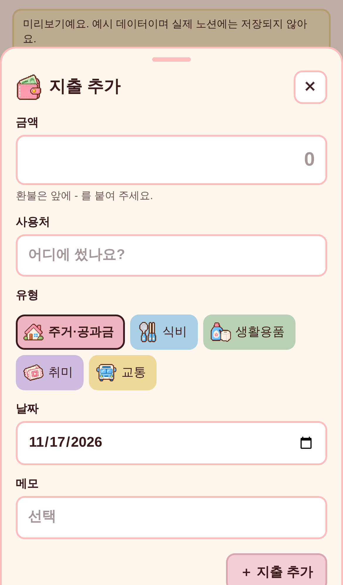

# 나의 작은 가계부 — 모바일 앱 (PWA)

노션 가계부(지출 기록 · 가계부 설정 DB)와 연결된 휴대폰용 가계부 앱이에요.
기존 노션 임베드 위젯과 **같은 Cloudflare Worker, 같은 노션 데이터, 같은 접근키**를 사용하므로
앱에서 입력한 지출이 노션 위젯에도 그대로 보여요.

| 기록 | 달력 | 결산 | 관리 | 지출 추가 |
|---|---|---|---|---|
|  |  |  |  |  |

## 기능

- **기록**: 한 달 예산 · 총 지출 · 남은 예산, 예산 사용률 막대, 날짜별 지출 목록(유형 필터)
- **지출 추가/수정/삭제**: 금액(천 단위 쉼표, 환불은 `-`), 사용처, 유형, 날짜, 메모
- **달력**: 날짜별 합계 → 누르면 그날 상세 내역과 바로 추가
- **결산**: 같은 색 유형 합산, 금액 높은 순 막대 차트 → 누르면 상세 내역
- **관리**: 월 예산, 유형(이름·색상·노션 이모지), 고정비, 할부, 결산 항목 이름, 화면 아이콘
- **앱처럼 설치**: 홈 화면 추가, 오프라인일 때 마지막으로 불러온 화면 표시

디자인은 기존 위젯 레퍼런스를 따랐어요: 배경 `#FFF6EE`, 테두리 `#FCBDBB` 2px, 글자 `#3A1A1B`,
총 지출 `#C31246`, 남은 예산 `#255E49`, 흰색 달력 칸, 픽셀 아이콘과 고양이 장식.

## 배포 (Windows, 본인 PC)

기존 가계부 위젯을 설치했던 PC에서 진행해요. Node.js와 Cloudflare 로그인이 이미 되어 있으면 됩니다.

1. 이 저장소를 내려받아 압축을 풉니다. (GitHub → Code → Download ZIP)
2. 기존 가계부 설치 폴더의 **`.widget-secret`** 파일(또는 `노션용-주소.txt`)을 이 폴더에 복사합니다.
   앱 주소에 접근키를 자동으로 붙이기 위한 것이며, 이 파일들은 GitHub에 올라가지 않아요.
3. **`UPDATE.cmd`** 를 더블클릭합니다.
4. 완료되면 생긴 **`앱-주소.txt`** 의 주소를 휴대폰으로 열고, 홈 화면에 추가합니다.
   - 아이폰(Safari): 공유 버튼 → 홈 화면에 추가
   - 안드로이드(Chrome): ⋮ → 홈 화면에 추가 / 앱 설치

노션 연결 토큰과 접근키는 Cloudflare에 이미 저장된 값을 그대로 쓰므로 다시 입력하지 않아요.
기존 노션 임베드 주소(`/`, `/records`, `/calendar`, `/monthly`, `/emoji-picker`)도 그대로 동작해요.
앱 주소는 `https://<기존 위젯 주소>/app/` 입니다.

## 미리보기

```bash
npm run build
```

`build/app-preview/index.html` 을 브라우저로 열면 예시 데이터로 앱을 둘러볼 수 있어요(노션에 저장되지 않음).
배포된 주소에서는 `/app/?demo=1` 로 볼 수 있어요.

## 개발

```bash
npm test
```

```
app/          모바일 앱 (app.html, manifest, service worker)
assets/       픽셀 아이콘, 고양이 장식, PWA 아이콘
widget/       기존 노션 임베드 위젯과 /api 서버 (변경 없음)
src/index.mjs Worker 진입점: /app/* 는 앱, 나머지는 기존 위젯·API
scripts/      빌드, 배포 스크립트
tests/        위젯 API 테스트 + 앱 라우팅 테스트
```

보안: 앱은 접근키를 휴대폰 브라우저 저장소에만 보관하고, 모든 노션 읽기·쓰기는
기존과 같이 Worker의 인증된 `/api/*` 를 거쳐요. 이 저장소에는 토큰·접근키가 들어 있지 않아요.
